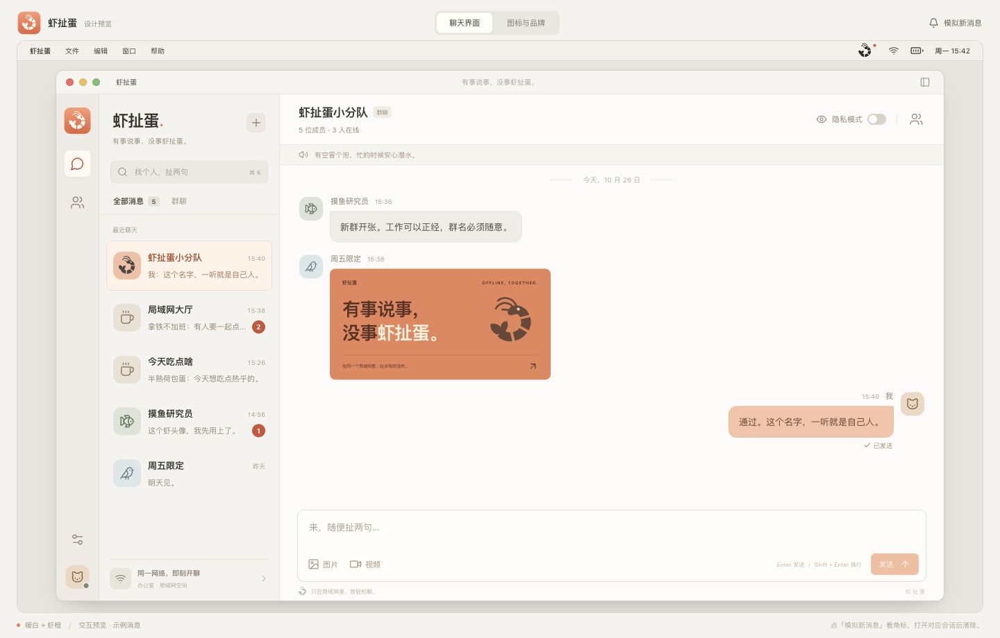

<p align="center">
  
</p>

# 虾扯蛋

有事说事，没事虾扯蛋。

一个面向局域网的轻量聊天工具。由一台电脑创建空间，同一网络里的朋友通过邀请加入，聊工作、发图片、分享视频。提供 React 网页界面和 Electron 桌面端，当前包含 macOS 打包支持。

## 能做什么

- 公共大厅、群聊和一对一私聊，使用 WebSocket 实时收发消息。
- 发送文字、图片和视频，支持上传进度与失败重试。
- 未读角标、消息已读状态、在线成员和聊天搜索。
- 自定义昵称和头像，通过完整邀请信息加入空间。
- 隐私模式隐藏聊天内容，macOS 菜单栏常驻与新消息提醒。
- 空间创建者可以移除成员，移除后自动更新邀请码。
- 使用 SQLite 保存消息，附件存储在空间主机上，无需外部数据库。

## 界面预览



上图为设计预览，使用示例消息；实际界面以运行中的应用为准。

## 本地运行

需要 Node.js **22.13.0 或以上**及 npm。克隆仓库并进入项目目录后安装依赖：

```bash
npm ci
```

### 桌面端

```bash
npm run desktop
```

在应用内创建空间，复制完整邀请给同一局域网内的朋友。对方打开应用，选择「加入空间」，粘贴邀请即可连接。提供空间的电脑需要保持应用运行。

### 网页端

```bash
npm run build
npm start
```

默认端口为 `4318`。首次创建空间时，在服务所在电脑上打开终端输出的完整本机链接（包含 `#setup=...`）。其他设备在浏览器中打开邀请里的局域网地址，使用邀请码加入。

可通过 `PORT` 修改端口，通过 `CHAT_DATA_DIR` 指定数据目录：

```bash
PORT=4318 CHAT_DATA_DIR=./.data npm start
```

网页版默认数据目录为 `.data/`；macOS 桌面端为兼容已有版本，继续使用 `~/Library/Application Support/邻聊/space/`。备份时请先退出应用或停止服务，再复制整个数据目录。

## 构建 macOS 安装包

在 macOS 上运行：

```bash
npm run package:mac
```

默认构建 Universal 应用，产物位于 `release/`，包括 `.app`、`.dmg` 和 `.zip`。仅构建指定架构时可使用：

```bash
MAC_ARCH=arm64 npm run package:mac
# Intel Mac：MAC_ARCH=x64 npm run package:mac
```

当前打包脚本使用本地临时签名，不包含 Apple 开发者签名或公证流程。

## 项目结构

| 目录 | 内容 |
| --- | --- |
| `src/` | React 界面、聊天交互与品牌样式 |
| `server/` | Express、WebSocket 服务与 SQLite 存储 |
| `desktop/` | Electron 主进程、菜单栏与 macOS 打包 |
| `shared/` | 邀请信息解析等共用逻辑 |
| `designs/xiachedan-preview/` | 独立设计预览和界面素材 |
| `assets/` | README 品牌海报 |

## 使用范围

适用于可信局域网。当前使用 HTTP 和 WebSocket，未实现端到端加密；隐私模式仅控制界面内容显示。聊天数据由空间主机保存，请勿直接将服务暴露到公网。

## 开源许可

采用 [MIT License](LICENSE)。欢迎通过 Issue 反馈问题，通过 Pull Request 改进项目。
