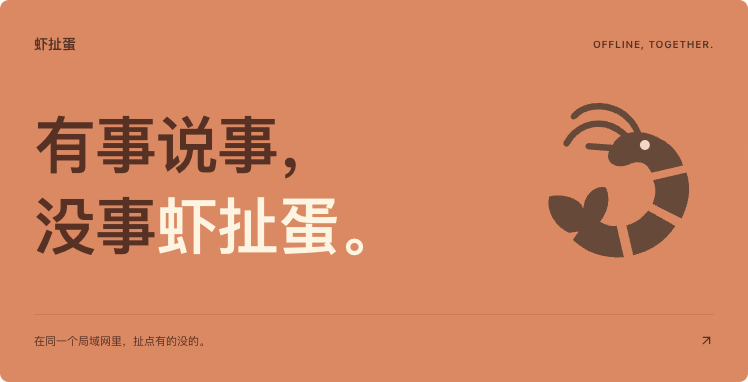
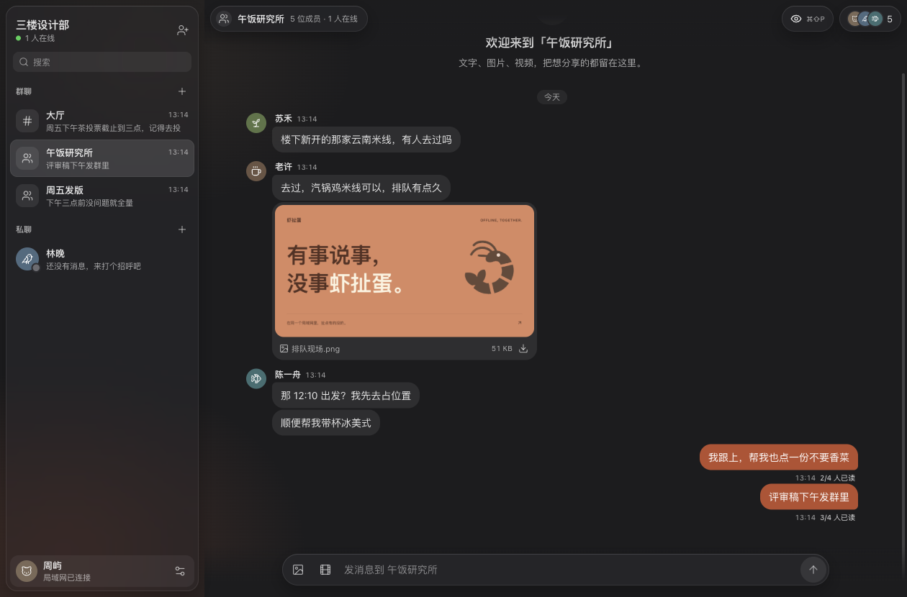

<p align="center">
  
</p>

# 虾扯蛋

[](https://github.com/ayogggua/xiachedan/actions/workflows/build.yml)

有事说事，没事虾扯蛋。

一个面向局域网的轻量聊天工具。由一台电脑创建空间，同一网络里的朋友通过邀请加入，聊工作、发图片、分享视频。提供 React 网页界面和基于 Tauri 的桌面端，支持 macOS 与 Windows。

## 能做什么

- 公共大厅、群聊和一对一私聊，使用 WebSocket 实时收发消息。
- 发送文字、图片和视频，支持上传进度与失败重试。
- 未读角标、消息已读状态（可查看群内谁已读、谁未读）、在线成员。
- 在会话成员面板中搜索当前会话的聊天记录，点击结果跳转到原消息。
- 自定义昵称和头像，通过完整邀请信息加入空间。
- 隐私模式隐藏聊天内容，鼠标停留在消息上才显示并计为已读；菜单栏 / 托盘常驻与新消息提醒，点击提醒直达对应会话。
- 浅色、深色与跟随系统三种外观。
- 空间创建者可以移除成员，移除后自动更新邀请码。
- 右键撤回自己发送的消息，同时清除原文和附件，更新已读状态与桌面通知。
- 空间创建者可以查看存储占用，清空整个空间的聊天记录和已发送附件，保留成员、头像和群聊。
- 使用 SQLite 保存消息，附件存储在空间主机上，无需外部数据库。

## 界面预览



上图为运行中的应用截图，使用示例消息。界面采用深色液态玻璃风格，窄屏（如手机浏览器）下会切换为会话列表与聊天两级页面。

## 本地运行

需要 Node.js **22.13.0 或以上**及 npm。克隆仓库并进入项目目录后安装依赖：

```bash
git clone https://github.com/ayogggua/xiachedan.git
cd xiachedan
npm ci
```

### 桌面端

桌面端基于 [Tauri 2](https://v2.tauri.app/)，还需要安装 [Rust](https://www.rust-lang.org/tools/install)（1.90 或以上）。macOS 需安装 Xcode 命令行工具，Windows 需安装 Visual Studio C++ 生成工具与 WebView2（Windows 11 已预装）。

```bash
npm run desktop
```

首次运行会下载随应用分发的 Node.js 运行时（校验官方 SHA-256）。

在应用内创建空间，复制完整邀请给同一局域网内的朋友。对方打开应用，选择「加入空间」，粘贴邀请即可连接。提供空间的电脑需要保持应用运行。

### 网页端

```bash
npm run build
npm start
```

默认端口为 `4318`。首次创建空间时，在服务所在电脑上打开终端输出的完整本机链接（包含 `#setup=...`）。其他设备在浏览器中打开邀请里的局域网地址，使用邀请码加入。

可通过 `PORT` 修改端口，通过 `CHAT_DATA_DIR` 指定数据目录：

```bash
PORT=4318 CHAT_DATA_DIR=./.data npm start
```

网页版默认数据目录为 `.data/`；桌面端为兼容已有版本，继续使用 `~/Library/Application Support/邻聊/space/`（Windows 为 `%APPDATA%\邻聊\space\`）。备份时请先退出应用或停止服务，再复制整个数据目录。

## 构建安装包

在 macOS 上构建本机架构的 `.app` 与 `.dmg`，在 Windows 上构建 NSIS 安装程序：

```bash
npm run package:mac
npm run package:win
```

产物位于 `src-tauri/target/release/bundle/`。交叉构建其他架构时先准备对应的运行时，再指定目标：

```bash
npm run build
node scripts/prepare-desktop.mjs x86_64-apple-darwin
npx tauri build --target x86_64-apple-darwin --bundles app,dmg
```

macOS 安装包使用本地临时签名，不包含 Apple 开发者签名或公证流程。

## 自动构建与发布

[GitHub Actions](https://github.com/ayogggua/xiachedan/actions/workflows/build.yml) 在提交到 `main` 时自动检查代码、构建网页端，并分别生成 Apple Silicon（`arm64`）、Intel（`x64`）Mac 安装包与 Windows（`x64`）安装程序。Pull Request 运行检查和网页构建，也可以从 Actions 页面手动运行完整构建。

运行成功后，在对应任务的 Artifacts 中下载 `xiachedan-mac-arm64`、`xiachedan-mac-x64`（DMG）或 `xiachedan-windows-x64`（安装程序），保留 14 天。`web-dist` 是网页静态资源，需要配合本项目服务端运行。

发布正式版本时，先更新 `package.json` 和 `package-lock.json` 中的版本，再推送对应的 `v版本号` 标签（如 `v1.3.0`）。工作流会校验版本号，打包成功后自动创建 [GitHub Release](https://github.com/ayogggua/xiachedan/releases) 并上传全部安装包。

## 项目结构

| 目录 | 内容 |
| --- | --- |
| `src/` | React 界面、聊天交互与品牌样式 |
| `server/` | Express、WebSocket 服务与 SQLite 存储 |
| `src-tauri/` | Tauri 桌面外壳：本机服务进程、菜单栏 / 托盘、系统通知与 `window.desktop` 接口 |
| `scripts/` | 桌面打包前准备 Node 运行时与服务资源 |
| `shared/` | 邀请信息解析等共用逻辑 |
| `designs/xiachedan-preview/` | 独立设计预览和界面素材 |
| `assets/` | README 品牌海报 |

## 使用范围

适用于可信局域网。当前使用 HTTP 和 WebSocket，未实现端到端加密；隐私模式仅控制界面内容显示。聊天数据由空间主机保存，请勿直接将服务暴露到公网。

## 开源许可

采用 [MIT License](LICENSE)。欢迎通过 Issue 反馈问题，通过 Pull Request 改进项目。
